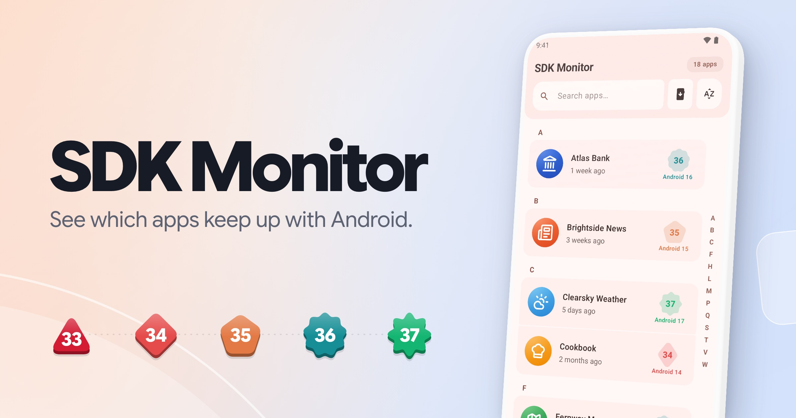
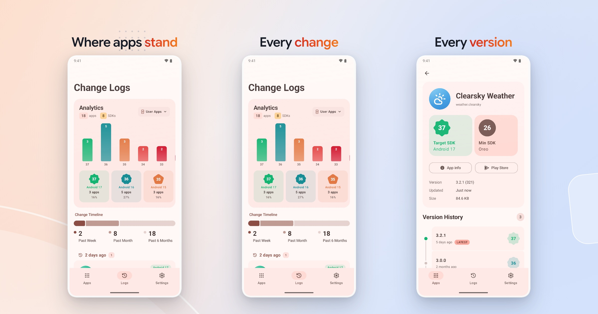
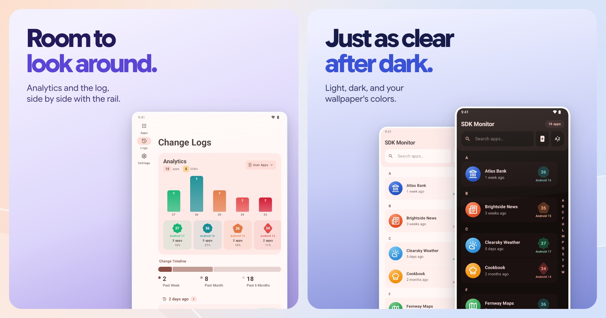
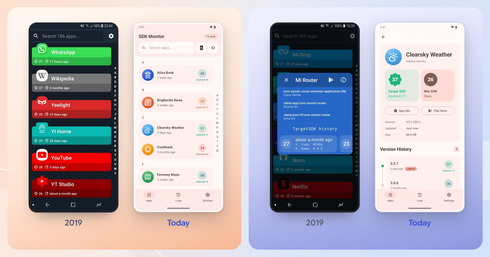

<h1 align="center">
  
</h1>

<p align="center"><strong>See which apps keep up with Android.</strong></p>

<p align="center">Every app declares the Android version it was built for, its <em>target SDK</em>, and that decides which of Android's newer privacy and security protections apply to it. Android never shows it. SDK Monitor shows it for every app on your phone, and keeps a record of every change.</p>

<p align="center">
  <a href="https://f-droid.org/packages/com.bernaferrari.sdkmonitor/"></a>
  <a href="https://apps.obtainium.imranr.dev/redirect?r=obtainium://app/%7B%22id%22%3A%22com.bernaferrari.sdkmonitor%22%2C%22url%22%3A%22https%3A%2F%2Fgithub.com%2Fbernaferrari%2FSDKMonitor%22%2C%22author%22%3A%22bernaferrari%22%2C%22name%22%3A%22SDK%20Monitor%22%7D"></a>
</p>

<p align="center">
  <a href="https://github.com/bernaferrari/SDKMonitor/releases/latest">Download the APK</a> · <a href="https://sdkmonitor.vercel.app/">Try it in your browser</a>
</p>

## Where your apps stand

<p align="center">
  
</p>

- **Every app at a glance.** Searchable, sorted by name or target SDK, each app marked with its level. The shape says how current it is: a green sun for the latest Android, down to a red triangle for apps far behind.
- **Where apps stand.** How many of your apps target each Android version, for your own apps, system apps or both. Tap a level to see the apps behind it.
- **Every change, kept.** When an update moves an app's target SDK, SDK Monitor logs it, so you see who keeps up and who falls behind, week by week.
- **Every version.** Target and minimum SDK, version and size, and a history of every version you have had.

## On a tablet, and after dark

<p align="center">
  
</p>

## From 2019 to now

<p align="center">
  
</p>

SDK Monitor first shipped in 2018. Every screen has since been rebuilt with Kotlin Multiplatform, Compose and Material 3 Expressive, and the app's ideas got sharper: the level now has a shape as well as a color, the change log has analytics on top, and the same screens run on a tablet and on the web.

## Private by design

- **No internet permission.** SDK Monitor cannot go online, so nothing about your apps leaves your phone. No account, no ads, no analytics.
- **Background checks, on your schedule.** It looks for changes as often as you choose and notifies you when an app moves its target SDK.
- **Your data, exportable.** Save everything as a CSV file whenever you like.
- **Light, dark and dynamic color**, in English, German, Spanish, French, Italian, Portuguese (Brazil), Japanese and Chinese.

## Why the target SDK matters

Each Android release adds protections, but an app only gets most of them once it targets that release. An app targeting an old level is exempt from them, even on the newest phone.

<details>
<summary>What each level brings</summary>

- **API 37** (Android 17): Advanced Protection Mode, post-quantum APK signing, Live Update APIs
- **API 36** (Android 16): Local network permission, adaptive layout requirements, health data permission changes
- **API 35** (Android 15): Private space, edge-to-edge enforcement, stricter foreground service limits
- **API 34** (Android 14): Partial photo and video access
- **API 33** (Android 13): Notification permission, themed app icons, per-app language preferences
- **API 32** (Android 12L): Better large screen support
- **API 31** (Android 12): Approximate location, clipboard access notices, Material You
- **API 30** (Android 11): Scoped storage enforced, one-time permissions, background location limits
- **API 29** (Android 10): Scoped storage, dark theme, gesture navigation
- **API 28** (Android 9): Cleartext traffic blocked by default, Apache HTTP client removed
- **API 26–27** (Android 8): Background execution limits, notification channels, adaptive icons
- **API 24–25** (Android 7): File provider requirement, Doze, multi-window
- **Below API 24**: None of the modern privacy and security protections

</details>

## Building from source

SDK Monitor is Kotlin Multiplatform with Compose and Material 3 Expressive: the Android app, and a web demo that runs the same screens on sample data.

```bash
git clone https://github.com/bernaferrari/SDKMonitor.git
cd SDKMonitor
./gradlew :app:assembleDebug                      # Android app
./gradlew :webApp:wasmJsBrowserDevelopmentRun     # web demo
```

The store and README images are regenerated from the app itself; see [store-listing/README.md](store-listing/README.md).

## License

[Apache License 2.0](LICENSE)
